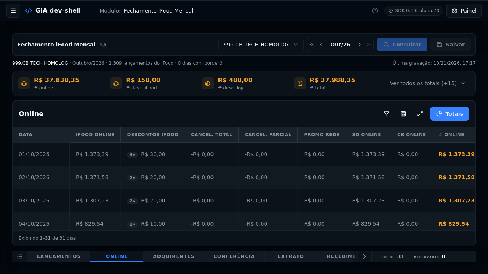
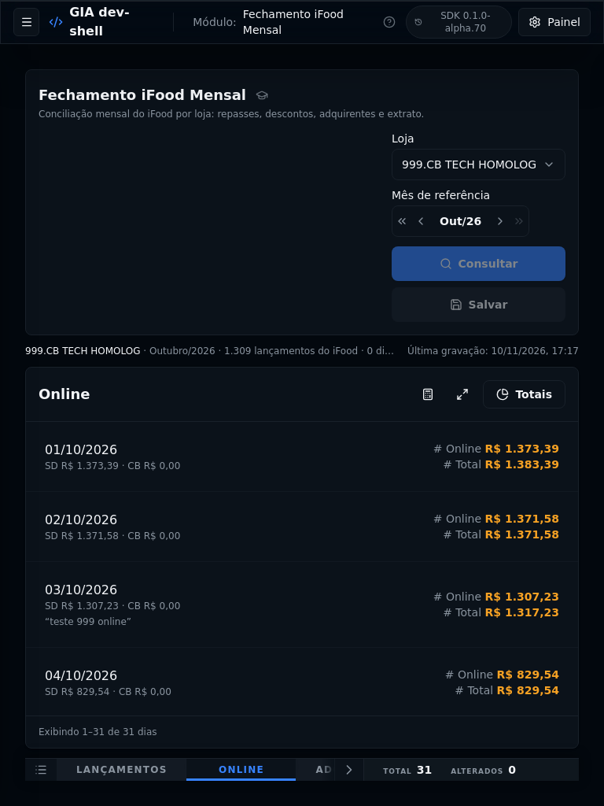
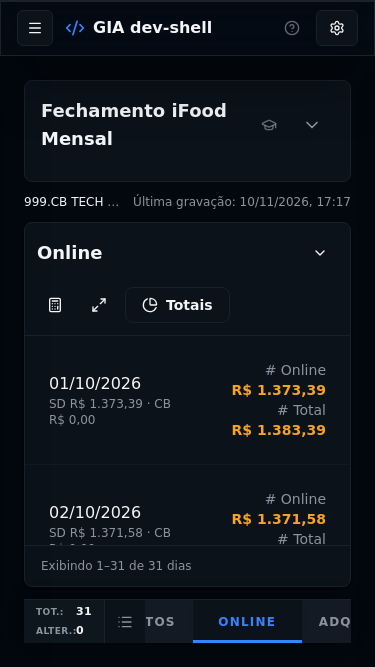

# Fechamento iFood Mensal

Módulo GIA — menu: Plataformas. Monta o **fechamento mensal do iFood** de uma
loja: busca os lançamentos financeiros do mês na API do iFood (em janelas de 8
dias, página a página) e confere com o caixa da loja (borderô do Maestro) —
Online, Adquirentes, Conferência (DRE), Extrato, Recebimento e Cancelados pós.
Quem tem permissão preenche os campos manuais e salva.

Porte da tela **Fechamento Mensal iFood** do GIA legado, com as mesmas regras de
cálculo e as mesmas tabelas. Produto, regras e pendências: [`PRD.md`](PRD.md).
Handoff para o time GIA: [`INTEGRATION.md`](INTEGRATION.md).
Mudanças por versão: [`CHANGELOG.md`](CHANGELOG.md).



| Tablet (768×1024)                        | Celular (375×667)                         |
| ---------------------------------------- | ----------------------------------------- |
|  |  |

## Desenvolver

```bash
cp .env.example .env   # credencial do iFood e banco do Maestro — ou GIA_DEV_IFOOD_MENSAL_DEMO=1
npm install
npm run dev            # gia dev — dev-shell em http://localhost:6010
npm run validate       # gia validate
npm run pack           # gia pack — gera o .tgz (+ Edge Function)
```

Com `GIA_DEV_IFOOD_MENSAL_DEMO=1` e sem `GIA_SERVER_DATABASE_URL`, os handlers devolvem
vendas e borderô fictícios para ver a tela sem credenciais (o Salvar exige o banco).

## Estrutura

- `src/server/` — handlers: `operacoes` (operações do escopo — a busca é por operação), `ledger` (uma página de uma janela
  do iFood + mapeamento do legado), `manual` (borderô + o gravado), `salvar`
  (transação nas tabelas `ifood_fechamento.*`).
- `src/hooks/use-consulta-mensal.ts` — a consulta janela a janela, com progresso e cancelamento.
- `src/regras.ts` + `src/conferencia.ts` — cálculos das abas (porte fiel do legado).
- `src/views/FechamentoIfoodMensalView.tsx` — filtros, estado editável e abas.
- `src/components/Aba*.tsx` — uma aba por arquivo.
